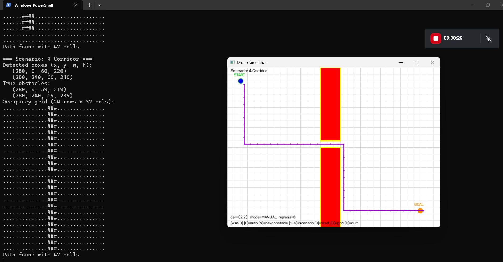
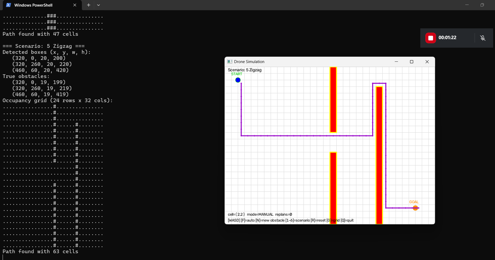
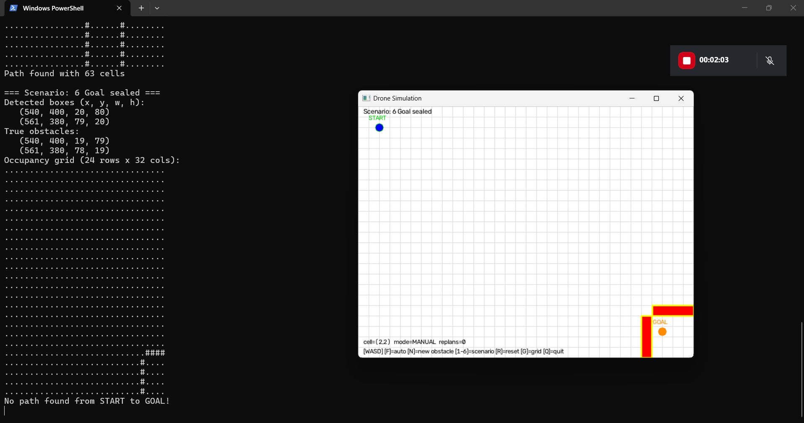
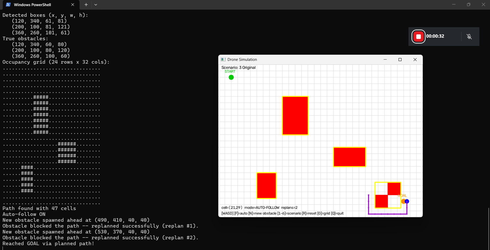

# AI-Based Obstacle Detection and Path Planning for a Simulated Autonomous Drone

BSERC Defence-Space Tech Internship Project, by Sivani S (Nov 1 - Nov 24, 2026).

A complete obstacle detection and path planning pipeline for a simulated drone, built with Python and OpenCV only. The drone "sees" its environment as an image, detects obstacles from pixels, plans a route with an A* algorithm written from scratch, flies the route, and replans when a new obstacle appears.

## Tech Stack

- Python 3.12
- OpenCV (opencv-python) and NumPy
- No other frameworks (ROS2, Gazebo and AirSim are future work, not part of this project)

## How It Works

1. **Simulated environment:** an OpenCV canvas (640 x 480 px, 20 px cells, 24 x 32 grid) with START, GOAL, red obstacles and the drone.
2. **Frame capture:** the rendered frame acts as the drone's camera view.
3. **Obstacle detection:** red obstacles are found from the pixels only (HSV mask with two red ranges + cv2.findContours), not from the known obstacle list.
4. **Occupancy grid:** detected boxes become a binary grid (0 = free, 1 = blocked).
5. **A* path planning:** written from scratch (open list, closed set, Manhattan heuristic, 4-directional moves).
6. **Drone movement:** the drone follows the planned path smoothly.
7. **Replanning:** if a new obstacle blocks the path ahead, A* is re-run from the drone's current cell.

Detected width and height are 1 px larger than the drawn values because OpenCV draws both edge pixels. The occupancy grid uses x + w - 1 and y + h - 1 as the last pixel.

## How to Run

Install the libraries:

```
pip install opencv-python numpy
```

Interactive window:

```
python environment.py
```

Keys: F = auto-follow, W/A/S/D = manual move, N = new obstacle, 1-6 = load scenario, R = reset, G = grid, Q = quit.

Headless tests (writes test_results.csv):

```
python environment.py --test
```

## Test Scenarios and Screenshots

Six scenarios test the pipeline, including one where no route exists.

| # | Scenario | What it tests |
|---|----------|---------------|
| 1 | Empty | Straight route with no obstacles |
| 2 | Long wall | A detour around one wall |
| 3 | Original | The three obstacles used since Day 1 |
| 4 | Corridor | A narrow gap between two walls |
| 5 | Zigzag | Two walls with gaps on opposite sides |
| 6 | Goal sealed | Goal inside a closed pocket, no route exists |

**Scenario 4 - Corridor:** the path goes through the narrow gap (47 cells).



**Scenario 5 - Zigzag:** the path weaves around both walls (63 cells).



**Scenario 6 - Goal sealed:** no route exists, and the program reports it instead of freezing.



**Scenario 3 - Dynamic replanning:** new obstacles spawned mid-flight (N key), the path was replanned twice, and the drone reached GOAL.



## Test Results

Every A* path is checked against an independent breadth-first search (BFS). Results are saved in test_results.csv.

| # | Scenario | Obstacles detected | Path (cells) | Optimal vs BFS | Dynamic replan | Result |
|---|----------|--------------------|--------------|----------------|----------------|--------|
| 1 | Empty | 0/0 | 47 | yes | OK | PASS |
| 2 | Long wall | 1/1 | 49 | yes | OK | PASS |
| 3 | Original | 3/3 | 47 | yes | OK | PASS |
| 4 | Corridor | 2/2 | 47 | yes | no route (correct) | PASS |
| 5 | Zigzag | 3/3 | 63 | yes | OK | PASS |
| 6 | Goal sealed | 2/2 | none | yes | n/a (no route) | PASS |

6 of 6 scenarios passed. In every scenario the detected grid matched the drawn obstacles.

## Demo Videos

Screen recordings are in the demo_videos folder:

- [Day 10: auto-follow along the A* path](demo_videos/Day10_AutoFollow_PathExecution.mp4)
- [Day 11: dynamic replanning around new obstacles](demo_videos/Day11_DynamicReplanning_NewObstacles.mp4)
- [Day 12: scenario testing](demo_videos/Day12_Scenario_Testing.mp4)

## Project Files

- `environment.py` - simulation, detection, occupancy grid, A*, BFS check, movement, replanning and test mode
- `test_results.csv` - results of the six test scenarios
- `screenshots/` - screenshots used in this README
- `demo_videos/` - demo recordings

## Progress

- [x] Day 1: Simulated environment - canvas, obstacle, drone, goal rendering
- [x] Day 2: Drone movement via keyboard controls (W/A/S/D)
- [x] Day 3: Start/goal markers, pixel-to-grid coordinate mapping
- [x] Day 4: Render loop, WASD control with obstacle collision, cell readout
- [x] Day 5: Cleanup, first GitHub commit, README status
- [x] Day 6: Obstacle detection from pixels (HSV mask + cv2.findContours)
- [x] Day 7: Verified detected boxes against true obstacles
- [x] Day 8: Detected boxes converted to a 24x32 occupancy grid
- [x] Day 9: A* path planning implemented from scratch
- [x] Day 10: Drone auto-follows the A* path (F key)
- [x] Day 11: Dynamic replanning when new obstacles appear (N key)
- [x] Day 12: Six test scenarios, BFS cross-check, headless test mode, demo video
- [x] Day 13: Scenario screenshots
- [x] Day 14: Final README
- [ ] Final polish and supervisor update

## Limitations and Future Work

This is a 2D simulation with 4-directional grid movement and no flight dynamics, so it demonstrates robotics fundamentals (detection, planning, replanning) rather than real flight. Possible next steps: diagonal moves, moving obstacles, and a ROS2-based simulation.
